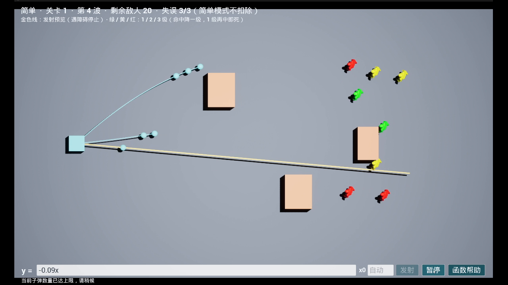
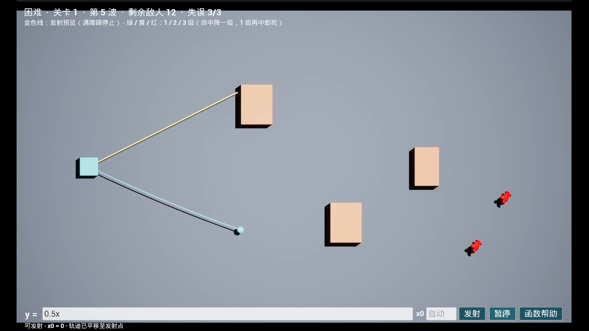

# FuncGame

一个使用 Unreal Engine 5.8 和 C++ 实现的俯视函数攻击游戏原型。玩家选择难度后，输入以 `x` 为变量的表达式，发射沿函数轨迹飞行的子弹，防守逐波出现的敌人。

## 下载试玩

[下载最新版 Windows 64 位试玩包](https://github.com/pikai-pk/FuncGame/releases/latest/download/FuncGame-Windows-Shipping-Release.zip) · [查看所有版本](https://github.com/pikai-pk/FuncGame/releases)

试玩包无需安装 Unreal Engine。完整解压后，打开 `Windows` 文件夹，双击 `FuncGame.exe` 启动；按 `Alt + F4` 退出游戏。需要 Windows 64 位系统和支持 DirectX 12 的显卡。如果提示缺少 Visual C++ 运行库，可运行包内的 `Engine/Extras/Redist/en-us/vc_redist.x64.exe`。

## 游戏视频

视频均使用 OBS Studio 录制，成片为静音。输入函数均严格控制在两位小数以内，展示平滑轨迹与精准防守。

### 简单模式：完整通关实录

演示第 1 波至第 5 波的完整防守通关过程，消灭全部 30 名敌人并展示「关卡胜利」结算界面。

[](Docs/FuncGame-Easy-Playthrough.mp4)

[下载简单模式视频](https://github.com/pikai-pk/FuncGame/releases/download/v0.1.1/FuncGame-Easy-Playthrough.mp4) · [仓库内直接查看](Docs/FuncGame-Easy-Playthrough.mp4)

### 困难模式：安全防守与第五波失误演示

第 1 至 4 波安全避开全部障碍物完成防守（保持 3/3 零失误）；在第五波使用 `y = 0.5x` 连续 3 次撞击障碍物，演示失误次数耗尽与「挑战失败」结算界面。

[](Docs/FuncGame-Hard-Playthrough.mp4)

[下载困难模式视频](https://github.com/pikai-pk/FuncGame/releases/download/v0.1.1/FuncGame-Hard-Playthrough.mp4) · [仓库内直接查看](Docs/FuncGame-Hard-Playthrough.mp4)

## 从源码运行

1. 安装 Unreal Engine 5.8、Visual Studio C++ 工具链和 Git LFS。克隆仓库前执行 `git lfs install`，克隆后确认资源已完整下载。
2. 打开 `FuncGame.uproject`，按提示编译项目。在编辑器中点击“运行”。默认使用引擎的 Entry 关卡，场地在运行时创建；原有第三人称示例内容仍在项目中。
3. 选择简单或困难模式。输入框只填写 `y=` 后的内容；例如 `x`、`x^2`、`3sin(5x)`。金色线是发射预览，会在障碍物处停止；可使用“暂停”停住战斗并调整函数，再点击“继续”和“发射”。游戏内的“函数帮助”介绍支持的函数、定义域和轨迹平移规则。

敌人触及左侧防线会导致失败。三级和二级敌人每次被命中都会降一级并改变颜色；一级敌人再被命中一次便会死亡。困难模式中，子弹三次撞到障碍物也会失败；简单模式的障碍物仍会消灭子弹，但不扣除失误次数。

## Unreal MCP

项目已为编辑器启用 UE 5.8 的 `ModelContextProtocol` 和 `AllToolsets` 插件。服务器可在编辑器控制台通过 `ModelContextProtocol.StartServer` 启动，也可在编辑器偏好设置中启用自动启动。默认本机地址是 `http://127.0.0.1:8000/mcp`。

在 Codex 使用的工作区根目录创建或合并 `.codex/config.toml`：

```toml
[mcp_servers.unreal_mcp]
url = "http://127.0.0.1:8000/mcp"
```

重新启动 Codex 会话后即可发现该服务器。服务器和工具集由运行中的 Unreal Editor 提供，编辑器关闭时连接不可用；编辑器的个人偏好设置不会提交到仓库。

## 配置

游戏参数位于 `Config/DefaultGame.ini` 的 `[/Script/FuncGame.FunctionGameMode]` 段。可调整敌人和子弹速度、子弹寿命与并发数、表达式和轨迹的计算预算，以及自动起点搜索范围。起点搜索使用一组固定候选值，`AutoStartSearchRange` 在 0 至 8 内限制候选范围；也可在游戏内手动输入起点。

`WaveComposition` 每项依次表示该波 1、2、3 级敌人的数量，默认五波合计 30 人。总敌人数随波次配置自动计算。每波至少需要两种等级，数量必须为非负整数；无效配置会回退到默认波次并在日志中提示。极端数值会受到保护性限制。

## 验证

Windows 上安装 Visual Studio C++ 工具链后，可在项目目录运行独立数学和规则测试：

```powershell
powershell -NoProfile -ExecutionPolicy Bypass -File Tests/Run-NativeTests.ps1
```

UE 自动化测试名称以 `FuncGame` 开头，可在编辑器的自动化测试界面运行，也可通过控制台命令 `Automation RunTests FuncGame` 运行。`FuncGame.World` 测试需要有已启动的游戏世界。

也可以在项目目录运行以下无图形测试（先把 `$ue` 设为本机 UE 5.8 安装目录）：

```powershell
& "$ue/Engine/Binaries/Win64/UnrealEditor-Cmd.exe" "$PWD/FuncGame.uproject" /Engine/Maps/Entry -game -nullrhi -unattended -nosplash -nosound -DisablePlugins=AllToolsets,ModelContextProtocol "-ExecCmds=Automation RunTests FuncGame" "-TestExit=Automation Test Queue Empty"
```

此命令只在该次无图形测试中停用编辑器 MCP 插件；正常打开编辑器时 MCP 仍可使用。

当前实现覆盖游戏内帮助列出的基础数值函数和条件表达式；符号求导、积分、求和及更广泛的特殊函数尚未实现。轨迹采样无法安全判断连续性时会保守停止。
